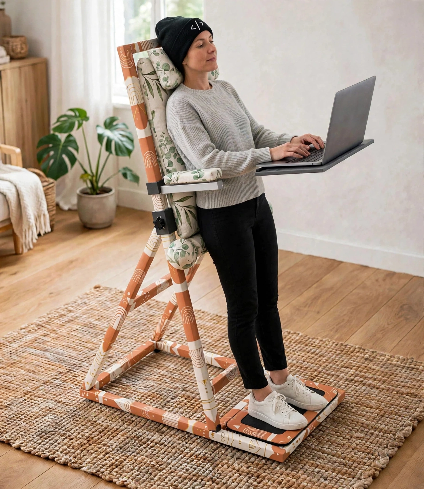

# Leaning Workstation

An open DIY design : a frame for working at a laptop while standing and leaning back. You stand on a foot platform, lean on a tilted backrest, and your forearms on pads and the laptop on a tilted tray in front of you.

The design is modelled in [OpenSCAD](https://openscad.org/) and shown on a one-page website with an interactive 3D viewer.

> **Status:** hobby design. It has not been load-tested or certified, and no real unit has been built yet. See [Safety](#safety) before building.



*AI-generated concept illustration, not a photo of a real build.*

---

## Project structure

```
LeanStandWorkstation/
├── index.html                          # the website (single page)
├── LICENSE                             # license for this project
├── README.md                           # this file
├── images/
│   ├── LeanStandWorkStationWithPerson.jpg   # hero concept image (person using the stand)
│   └── LeanStandWorkStation.jpeg            # concept image of the frame
└── scad/
    └── LeanStandWorkStation.scad       # the parametric 3D model (design source)
```

| File / folder | What it is for |
|---|---|
| `index.html` | The whole website: header with GitHub link and mobile menu, hero, interactive 3D model, "how it works", concept image, key dimensions table, materials and parts list, safety note. HTML, CSS and JavaScript are all in this one file. |
| `scad/LeanStandWorkStation.scad` | The **design source**. A parametric OpenSCAD model with all dimensions, angles, tube sizes, gusset plates and clamps. The website loads this file and shows it in the 3D viewer. Edit this file to change the design. |
| `images/LeanStandWorkStationWithPerson.jpg` | AI-generated concept image used in the hero section. |
| `images/LeanStandWorkStation.jpeg` | AI-generated concept image used in the "Concept image" section. |
| `LICENSE` | The license that covers this project. |
| `README.md` | Project overview and instructions. |

---

## How the website works

- The page is plain HTML, CSS and JavaScript. There is no build step and no dependencies to install.
- When the page loads, a script fetches `scad/LeanStandWorkStation.scad` and passes the code to an embedded online OpenSCAD viewer (`ochafik.com/openscad2`) inside an `<iframe>`.
- The script also turns on the dimension lines in the web view by setting `annotations_preview_only = false;` in the code it sends. The file itself is not changed.
- The first load of the 3D model can take 10-30 seconds.


## The 3D model

Open `scad/LeanStandWorkStation.scad` in desktop OpenSCAD to edit the design, render it, or export it (STL, etc.).

- All values are in **millimetres (mm)**; angles are in **degrees**.
- In the model, **red lines** are dimension lines and **blue text** is the value in mm.
- Dimension lines are drawn in preview only by default (`annotations_preview_only = true`). The website switches this off so they show in the web viewer.
- Main dimensions are set as named variables at the top of the file, so you can adjust the design to fit your body.

### Key dimensions

| Variable | Value | What it is |
|---|---|---|
| `lean_angle` | 15° | Lean from vertical |
| `apex_height` | 1,000 mm | Height of the top joint where the upright meets the rear leg |
| `pelvic_height` | 710 mm | Height of the pelvic roller from the floor |
| `armrest_height` | 1,120 mm | Height of the forearm rests |
| `laptop_forward_clearance` | 115 mm | Gap between the armrest pads and the tray |
| `tray_tilt` | 15° | Tilt of the laptop tray |
| `tray_width × tray_depth` | 660 × 300 mm | Laptop tray size |
| `backboard_height × width` | 1,020 × 500 mm | Backrest board size |
| `base_length × base_width` | 1,140 × 660 mm | Base footprint |
| `total_spine_len` | 2,000 mm | Length of the front uprights |

The heights are a starting point for an average adult. Adjust them to fit you.

---

## Materials

The model is designed in mild steel square tube.

**Steel**

- Main tube: 40 × 40 mm square tube, 2.5 mm wall
- Armrest rails: 30 × 30 mm square tube, 2 mm wall
- Gusset plates: 5 mm mild steel
- Clamp plates: 4.5 mm mild steel with 1.5 mm rubber liner
- Frame joints: M8 bolts through plates
- Tools: drill, metal saw, files

**Other parts**

- Backrest: 12 mm plywood board with 50 mm foam
- Pelvic roller: 58 mm diameter, about 612 mm long
- Forearm pads: 240 × 75 × 30 mm
- Laptop tray: 660 × 300 × 14 mm
- Foot platform: about 540 × 335 mm

### Parts list (approximate) ( Not Tested , Not Builded Yet , AI Generated )

| Part | Qty | Size (mm) |
|---|---|---|
| 40 × 40 tube, base side rails | 2 | 1,140 |
| 40 × 40 tube, front uprights | 2 | about 2,000 |
| 40 × 40 tube, rear legs | 2 | about 1,060, trim at the joints |
| 40 × 40 tube, crossbars | 9 | 580 (4 base, 4 upright, 1 rear) |
| 30 × 30 tube, armrest rails | 2 | about 680 |
| 5 mm gusset plates | 12 | shapes are in the model |
| M8 bolts, nuts, washers | about 36 for the frame | plus clamp bolts |
| Friction clamps | 4 | 2 plates each, bolts and a rubber liner |

Counts are approximate and taken from the model. Check them against the 3D view before you cut anything. An aluminum build with the same layout is possible, but it is not modelled here.

---

## Safety

This is a hobby design. It has not been load-tested or certified, and no real unit has been built yet.

You lean your whole body weight on it, so:

- Use good bolts and check every joint.
- Test it with a low lean and your feet on the floor before you rely on it.
- The height clamps rely on friction. Check them often, and consider adding a pin through the tube at each set height.

Build and use it at your own risk.

---

## Images

The images in this project are **AI-generated concept illustrations** of the idea. They are not photos of a real, finished build, and small details may differ from the design. The 3D model is the design reference.

---

## Contributing

Ideas, fixes and improvements are welcome. Open an issue or a pull request on GitHub: <https://github.com/a-s-l-a-h/Leaning-Workstation>

Useful contributions: photos and notes from a real build, load-testing results, and adjustments for different body heights , New Features , And Upgrading features . 

---

## License

See the [LICENSE](LICENSE) file.